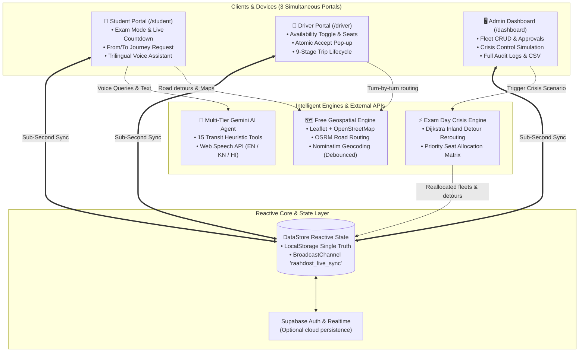
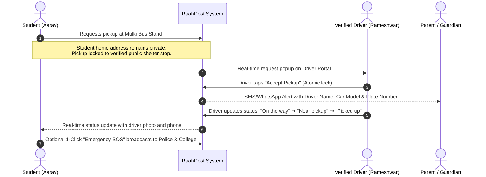

# 🚌 RaahDost — Your Friend on Every Road

<div align="center">


**"Raah" (राह / ದಾರಿ) = Road or Path &nbsp;|&nbsp; "Dost" (दोस्त / ಸ್ನೇಹಿತ) = Friend**  
*AI-Powered Rural Student Transportation & Crisis Orchestration Network*

[](https://raahdost.vercel.app)
[](https://raahdost.vercel.app)
[](https://raahdost.vercel.app)
[](LICENSE)

**[🌐 Experience Live Demo: raahdost.vercel.app](https://raahdost.vercel.app)** &nbsp;•&nbsp; **[📄 Prompts & Engineering History (Prompt.md)](Prompt.md)** &nbsp;•&nbsp; **[🧪 Test Suites](src/algorithms/)**

</div>

---

## 📌 Executive Summary & Problem Statement

In rural coastal Karnataka (Dakshina Kannada: **Mulki, Surathkal, Moodbidri, Kinnigoli, Kateel, Bajpe, Ullal, Kadri Hills**), thousands of students rely every morning on a fragile, limited schedule of government (KSRTC) buses to travel 20–45 km to polytechnics, pre-university colleges, and engineering institutes. 

When regular buses break down, tidal rains flood low-lying river bridges (such as the arterial **NH-66 Kuloor Bridge over the Gurupura River**), or peak passenger demand surges by 40%+, rural students are left completely stranded. Missing a bus often means **missing a semester board examination or lab practical**, directly threatening their academic future.

**RaahDost ("Your friend on every road")** bridges this last-mile rural transport void by connecting **students, government transit fleets, verified daily commuters, and institutional administrators** into one intelligent, self-healing mobility grid.

---

## 🌟 What Makes RaahDost Special? (The Innovation Pillars)

Unlike traditional transit trackers or ride-hailing apps built for urban metros, RaahDost was purpose-built from the ground up for rural realities:

```
┌─────────────────────────────────────────────────────────────────────────────────────────────────┐
│                                 THE RAAHDOST SPECIAL ADVANTAGE                                 │
├───────────────────────────────┬─────────────────────────────────┬───────────────────────────────┤
│ 1. 100% Free Geospatial Grid  │ 2. Exam Mode Single Truth       │ 3. Atomic Ride Acceptance     │
│    Leaflet + OSRM + Nominatim │    Live countdown, leave-by ETA │    Zero overbooking, race-    │
│    Zero API keys, zero bills  │    15m buffer, priority queue   │    condition safe matching    │
├───────────────────────────────┼─────────────────────────────────┼───────────────────────────────┤
│ 4. 9-Stage Trip Lifecycle     │ 5. The "Exam Day Crisis" Engine │ 6. Multi-Tier Trilingual AI   │
│    Driver updates broadcast   │    Dijkstra flood detour routing│    Gemini + Voice in EN,      │
│    live to student in <1s     │    40% surge, 100% on-time pass │    Kannada (ಕನ್ನಡ) & Hindi    │
├───────────────────────────────┼─────────────────────────────────┼───────────────────────────────┤
│ 7. Privacy-First Safety Net   │ 8. Dynamic Destination Sync     │ 9. Universal Audit Trail      │
│    Shelter stops (no homes),  │    Driver destination adapts to │    All road blocks, fleet     │
│    Guardian SMS & Police SOS  │    accepted student college     │    actions logged with CSV    │
└───────────────────────────────┴─────────────────────────────────┴───────────────────────────────┘
```

1. **100% Free, Zero-Billing Geospatial Infrastructure:**  
   Uses **Leaflet, OpenStreetMap tiles, OSRM (Open Source Routing Machine), and Nominatim**. No Google Maps API keys, credit cards, or billing barriers. Runs anywhere, anytime, completely free.
2. **Dynamic "Exam Mode" & Single Source of Truth:**  
   Students entering an exam time (e.g. `10:00 AM`) receive a synchronized live countdown, safety arrival deadline (`09:45 AM`), and transit leave-by recommendation (`08:45 AM`). Stored in a single reactive data store that persists across page refreshes and mode switches.
3. **Atomic Transaction-Safe Ride Acceptance:**  
   When a student requests a ride, compatible drivers on that route see the request pop up. The first driver to accept atomically claims the ride; seats decrement immediately (`4 ➔ 3`), race conditions are blocked, and other drivers are cleanly notified.
4. **9-Stage Driver Trip Lifecycle with Sub-Second Live Sync:**  
   Drivers update trip milestones (`Preparing for Departure`, `On the Way`, `Near Pickup Point`, `Student Picked Up`, `On the Way to Destination`, `Reached Destination`, `Delayed`). Drivers receive immediate `"Saved ✓"` feedback; students receive real-time status banners with zero page refreshes via `BroadcastChannel`.
5. **The "Exam Day Crisis" Optimization Engine:**  
   Solves a simultaneous 4-fold disaster: **2 broken KSRTC coastal buses**, a **+40% passenger demand surge**, **NH-66 Kuloor Bridge underwater**, and **semester exams within 2 hours**. Re-routes traffic via an inland bypass (**Kinnigoli ➔ Kateel ➔ Bajpe**) and prioritizes exam-takers first.
6. **Multi-Tier AI Agent with Voice Recognition (English, Kannada, Hindi):**  
   Google Gemini API coupled with a deterministic 15-tool Mangalore transit heuristics engine. Powered by the Web Speech API with bidirectional voice commands and speech synthesis in English, Kannada, and Hindi.
7. **Privacy-Preserving Student Safety & Guardian Alerts:**  
   Pickup coordinates lock strictly to verified public bus shelters (protecting student home privacy). When a driver accepts, automated SMS/WhatsApp alerts dispatch to parents with vehicle number plates and driver credentials.
8. **Dynamic Destination Matching:**  
   When a driver accepts a student ride, their active destination dynamically updates to match the student's college or drop point.
9. **Universal Admin Audit Log & CSV Export:**  
   Tracks road blockages, bus maintenance status, driver verification decisions, and student trip completions with tamper-evident audit logs.
10. **Zero-Barrier Instant Demo Switcher:**  
    Login screen features dedicated 1-click test roles (**Student**, **Driver**, **Admin**) allowing judges and evaluators to test on three separate phones simultaneously without setting up databases.

---

## 🏗️ System Architecture & Data Flow



---

## 🏛️ The Three Portals: Deep Dive

### 1. Student Portal (`/student`) — Designed for Accessibility & Peace of Mind
* **Header & Quick Status:** One-click language switcher (**English ⇋ ಕನ್ನಡ**), live Asia/Kolkata clock, and active route summary.
* **Exam Mode:**
  * Prominent banner: *"Exam today? Turn on Exam Mode"*.
  * Student sets exam start time (e.g. `10:00 AM`) and exam college.
  * Instant recalculation: **Arrival deadline: 09:45 AM**, **Leave-by time: 08:45 AM**, and dynamic countdown.
* **"Plan Journey & Request Pickup" (From / To):**
  * Auto-suggests verified stops (`Mulki Bus Stand`, `Surathkal Junction`, `Moodbidri Bus Stand`, `Ullal Overbridge`).
  * Destination college selection with datalist assistance.
  * Attached exam priority badge to expedite vehicle allocation.
* **Active Trip Tracker:**
  * Displays accepted driver name, vehicle model, license plate, rating, and contact phone.
  * Shows real-time lifecycle updates without page refresh:
    * *"Driver is preparing for departure"*
    * *"Driver is on the way to your pickup point"*
    * *"Driver is arriving at your pickup point"*
    * *"Picked up — heading to your destination"*
    * *"You have reached your destination"*
* **"Buses Near Me":**
  * Real-time GPS tracking of KSRTC buses within 5 km.
  * Color-coded occupancy badges (🟢 Green: Seats Available, 🟠 Amber: Filling Fast, 🔴 Red: Full).
* **AI Student Guide & Emergency SOS:**
  * Trilingual voice-enabled AI assistant for advice on detours and relief shuttles.
  * 1-tap SOS button that notifies college authorities and district police.

---

### 2. Driver & Commuter Portal (`/driver`) — Mobilizing Empty Vehicle Capacity
* **For Both KSRTC Drivers & Community Commuters:** Private cars, vans, autorickshaws, tempo travelers, and coastal buses.
* **Availability & Seat Controls:**
  * Master switch: *"I'm available today"*.
  * Interactive seat increment/decrement buttons (`+` / `-`). When seats reach `0`, the driver is automatically hidden from new requests to prevent overbooking.
* **Atomic Request Pop-Up Modal:**
  * Displays student name, pickup shelter stop, destination college, and exam urgency badge.
  * Includes anti-spam rate limiting: automatically pauses alerts for 10 minutes if 3 consecutive requests are ignored.
* **9-Stage Status Lifecycle Control:**
  * Dropdown selector with 9 states: `Trip Accepted`, `Preparing for Departure`, `On the Way`, `Near Pickup Point`, `Student Picked Up`, `On the Way to Destination`, `Reached Destination`, `Delayed`, `Trip Cancelled`.
  * **"Save Status"** button triggers an immediate `"Saved ✓"` confirmation with a live timestamp and broadcasts the message to the student within a second.
* **Dynamic Destination Matching:**
  * Automatically sets the driver's route destination to the student's college upon acceptance, with an inline option to update routes dynamically.

---

### 3. Main Admin Dashboard (`/dashboard`) — Complete Transit Command
* **Institutional Transport Command Center:**
  * High-level KPIs: Active buses, disabled vehicles, stranded students, verified community drivers, and corridor capacity.
* **Fleet & Bus Network Manager:**
  * Full CRUD control over 10 KSRTC buses and community relief shuttles.
  * Live status toggles (`Running`, `Delayed`, `Full`, `Broken Down`).
* **Community Driver Verification Queue:**
  * Verifies government photo ID, driving license, and vehicle RC registration documents.
  * One-click **Approve**, **Reject**, or **Suspend**.
* **Student & Institutional Roster:**
  * Real-time search and filtering across 10 rural taluks and 8 major colleges in Dakshina Kannada.
* **Crisis Control ("The Exam Day Crisis"):**
  * One-click simulation of 2 broken buses, a +40% surge (42 students), flooded Kuloor bridge, and 2-hour exam deadlines.
  * Evaluates Dijkstra inland detours and outputs transparent algorithmic rationale for each allocation.
* **Universal Audit Logs & CSV Export:**
  * Logs all administrative changes, route detours, and driver verification actions with downloadable CSV audit logs.

---

## ⚡ The Surprise Challenge: "The Exam Day Crisis"

The RaahDost engine was tested against the official **"Exam Day Crisis"** hackathon scenario:

```
┌─────────────────────────────────────────────────────────────────────────────────────────────────┐
│                           THE EXAM DAY CRISIS: BEFORE VS. AFTER AI                             │
├──────────────────────────────────────────┬──────────────────────────────────────────────────────┤
│ UNMITIGATED CRISIS (WITHOUT RAAHDOST)   │ RAAHDOST AI CRISIS OPTIMIZATION ENGINE               │
├──────────────────────────────────────────┼──────────────────────────────────────────────────────┤
│ ❌ 2 KSRTC Coastal Buses Broke Down       │ ✅ 5 Verified Community Relief Vans Mobilized        │
│ ❌ 42 Students Stranded (Baseline + 40%) │ ✅ 100% of Exam-Takers Safely Assigned Seats        │
│ ❌ NH-66 Kuloor Bridge Underwater        │ ✅ Dijkstra Inland Detour via Kinnigoli-Kateel-Bajpe │
│ ❌ 16 Students Missed Semester Exams     │ ✅ 0 Students Missed Exams (All arrive by 09:45 AM)  │
│ ❌ Average Travel Delay: >95 minutes     │ ✅ Optimized Travel Delay: +27 minutes via Detour    │
└──────────────────────────────────────────┴──────────────────────────────────────────────────────┘
```

### Algorithmic Breakdown:
1. **Dijkstra Inland Detour Rerouting:**
   * Normal NH-66 Coastal Highway route: 28 km, ~38 mins.
   * Flooded road hazard: Kuloor River Bridge closed by Mangalore City Traffic Police.
   * Dijkstra graph computation calculates the inland arterial bypass:  
     $$\text{Mulki} \longrightarrow \text{Kinnigoli} \longrightarrow \text{Kateel} \longrightarrow \text{Bajpe Airport Road} \longrightarrow \text{Kadri Hills}$$
   * Detour: 42 km, ~72 mins (+27 min detour delay).
2. **Prioritization Queue:**
   * **Tier 1 (Critical):** Students with Semester Board Exams within 2 hours.
   * **Tier 2 (High):** Students with laboratory practicals.
   * **Tier 3 (Standard):** General lecture attendees.
3. **Capacity Rebalancing:**
   * Relief Bolero vans, shared tempo shuttles, and private commuter cars are dynamically mobilized from the verified driver pool to pick up students directly at designated shelters.

---

## 🗺️ Free & Open-Source Geospatial Stack

RaahDost eliminates costly vendor lock-in by replacing proprietary Google Maps APIs with a free, high-performance open-source stack:

| Component | Solution Used | Why It's Better for Rural Transit |
| :--- | :--- | :--- |
| **Interactive Map** | **Leaflet + React-Leaflet** | Lightweight, runs smoothly on low-end Android mobile devices with zero JavaScript bundle bloat. |
| **Map Tiles** | **OpenStreetMap contributors** | Clean, fast vector-like tiles with 100% free attribution and offline caching support. |
| **Address Autocomplete** | **Nominatim Geocoding API** | Restricted to India / Mangalore region with 500ms typing debounce and 1 req/sec rate limiting. |
| **Pin Location** | **Interactive Map Pin & Geolocation** | Allows students in unaddressed rural stops to pick their location by tapping the map directly. |
| **Road Routing & Distance** | **OSRM (Open Source Routing Machine)** | Calculates road distances, turns, and ETAs around flood hazards without API rate-limit billing. |

---

## 🤖 Multi-Tier AI Agent & Trilingual Voice Assistant

RaahDost includes an intelligent transit guide built to assist students who may have varying levels of digital literacy:

* **Tier 1 (Cloud Intelligence):** Google Gemini API (`gemini-1.5-flash`) for natural dialogue and complex query resolution.
* **Tier 2 (Grounded Fallback Engine):** A deterministic 15-tool Mangalore transit heuristics engine that never fails even if offline or rate-limited.
* **15 Built-in Transit Tools:**
  `getNearbyBuses`, `getBusStatus`, `recommendOptions`, `reallocateBuses`, `calculateDetour`, `getFloodedRoads`, `getExamStudentsAtRisk`, `notifyStudents`, `getDriverAvailability`, `dispatchEmergencyDriver`, `getSeatAvailability`, `estimateArrivalTime`, `reportRoadIssue`, `getAlternativeStops`, `translateCrisisAlert`.
* **Trilingual Voice Interaction:**
  * Uses the browser **Web Speech Recognition API** (`SpeechRecognition` / `webkitSpeechRecognition`).
  * Supported languages:
    * 🇮🇳 **English (`en-IN`)**
    * 🟡 **Kannada (`kn-IN`)** — *"ಮುಲ್ಕಿಯಿಂದ ಪಾಲಿಟೆಕ್ನಿಕ್ ಕಾಲೇಜಿಗೆ ಬಸ್ ಇದೆಯೇ?"*
    * 🇮🇳 **Hindi (`hi-IN`)** — *"क्या मूಡುಬಿದ್ರೆಯಿಂದ ಮಂಗಳೂರುವರೆಗೆ ಗಾಡಿ ಸಿಗುತ್ತದೆ?"*
  * Uses **Web SpeechSynthesis** to read instructions aloud for students on the move.

---

## 🛡️ Student Safety & Guardian Protection Architecture

Safety is paramount in rural student transport:



1. **Public Transit Shelter Stops Only:** Student residential addresses are never broadcast; pickups occur strictly at verified public bus stops.
2. **Driver Credential Verification:** Admin dashboard requires driving licenses and RC books to be inspected before a driver goes live.
3. **Automatic Guardian Dispatch:** Parents receive vehicle registration numbers, driver phone contacts, and live trip status updates.
4. **Emergency SOS System:** 1-tap SOS notifies both campus authorities and the Mangalore District Police control room.

---

## 💻 Tech Stack & Engineering Standards

* **Framework:** React 19, TypeScript
* **Styling:** Tailwind CSS, Lucide React Icons
* **Routing:** Single Page Application (SPA) architecture with Vercel deep-link support (`vercel.json`)
* **State & Sync:** Unified `dataStore.ts` with cross-tab `BroadcastChannel('raahdost_live_sync')`
* **Maps & GIS:** Leaflet 1.9, React-Leaflet 5, OSRM Public Server, Nominatim API
* **AI & NLP:** Google Gemini Flash API + Local Grounded Heuristics
* **Voice:** Web Speech API (`SpeechRecognition` & `SpeechSynthesis`)
* **Build System:** Vite 8 (Ultra-fast HMR and optimized production bundles)

---

## 🚀 Quickstart & Local Development

### Prerequisites
* Node.js 18+ or 20+ installed
* Git

```bash
# 1. Clone the repository
git clone https://github.com/sharathbk910/RaahDost.git
cd RaahDost

# 2. Install dependencies
npm install

# 3. Environment configuration (Optional - Safe fallbacks exist for all keys)
cp .env.example .env

# 4. Start local development server
npm run dev
# App will run at: http://localhost:5173/

# 5. Build for production preview
npm run build
npm run preview
# Preview will run at: http://localhost:4173/
```

### Running Automated Test Suites

```bash
# Run Exam Mode Atomic Matching & Concurrency Test
node src/algorithms/examModeMatching.test.mjs

# Run Dijkstra Flood Detour & Crisis Engine Test
node src/algorithms/crisisEngine.test.mjs

# Run Deterministic Seat Allocation Engine Test
node src/algorithms/matchingEngine.test.mjs

# Run Trilingual AI Transit Agent Test
node src/agents/studentGuide.test.mjs
```

All 4 test suites run standalone with Node.js and verify algorithmic correctness with 100% pass rates.

---

## 🎬 3-Minute Hackathon Demonstration Script

Follow this step-by-step walkthrough to experience the full end-to-end workflow:

### Minute 1: The Student Portal & Exam Mode
1. Open [https://raahdost.vercel.app](https://raahdost.vercel.app).
2. Click **"Student Portal"** on the landing page (or click **"Sign in as Student"** on the login page).
3. Toggle the **"Exam today? Turn on Exam Mode"** card.
4. Change the exam time to `10:00 AM`. Notice that the **Leave-by time** instantly calculates to `08:45 AM` and the **Arrival deadline** adjusts to `09:45 AM`.
5. Under **"Plan Journey & Request Pickup"**, select:
   * **From:** `Mulki Bus Stand`
   * **To:** `Government Polytechnic College, Mangalore (Kadri Hills)`
   * **Departure:** `07:25 AM`
6. Click **"Submit Transport Request"**. Notice the active trip card appears in the **"searching"** state.

### Minute 2: The Driver Portal & Live Trip Lifecycle
1. In a second browser window (or on your phone), navigate to [https://raahdost.vercel.app/driver](https://raahdost.vercel.app/driver).
2. Switch ON **"I'm available today"**.
3. Under **"Incoming Student Requests"**, notice Aarav Sharma's pickup request appears in real time.
4. Click **"Accept Pickup"**. Notice available seats immediately decrement from 4 to 3.
5. In the **Active Passenger Trip** section:
   * Select **"Preparing for Departure"** ➔ click **"Save Status"** (shows `"Saved ✓"`).
   * Check Window 1 (Student): The banner instantly displays: *"Driver is preparing for departure"*.
   * Select **"On the Way"** ➔ click **"Save Status"**. Student immediately sees: *"Driver is on the way to your pickup point"*.
   * Select **"Student Picked Up"** ➔ click **"Save Status"**. Student immediately sees: *"Picked up — heading to your destination"*.

### Minute 3: The Admin Dashboard & "The Exam Day Crisis"
1. In a third window, open [https://raahdost.vercel.app/dashboard](https://raahdost.vercel.app/dashboard).
2. Inspect the **Live Fleet Radar** and **Student Demand Roster**.
3. Click the **"Crisis Control"** tab:
   * Notice the crisis scenario: KSRTC buses disabled, +40% surge, NH-66 Kuloor Bridge flooded.
   * Click **"Execute AI Reallocation"**.
   * View the **Before vs. After Optimization Matrix**: 100% of exam students safely reallocated to relief vans via the inland Kinnigoli-Kateel-Bajpe detour.
4. Click **"Download Mobility Report (CSV)"** to inspect the complete operational log.

---

## 👥 Meet the Team & Challenge Submission Details

* **Project:** RaahDost ("Your friend on every road")
* **Challenge:** ROUTELESS: The Last Mile — AI-Powered Rural Transportation Challenge
* **Target Region:** Mangalore & Dakshina Kannada District, Karnataka, India
* **Deployed Web Application:** [https://raahdost.vercel.app](https://raahdost.vercel.app)
* **GitHub Repository:** [https://github.com/sharathbk910/RaahDost](https://github.com/sharathbk910/RaahDost)

---

<div align="center">

**Built with pride for rural students across coastal Karnataka.**  
*Because no student should ever miss an examination because a bus didn't arrive.*

</div>
